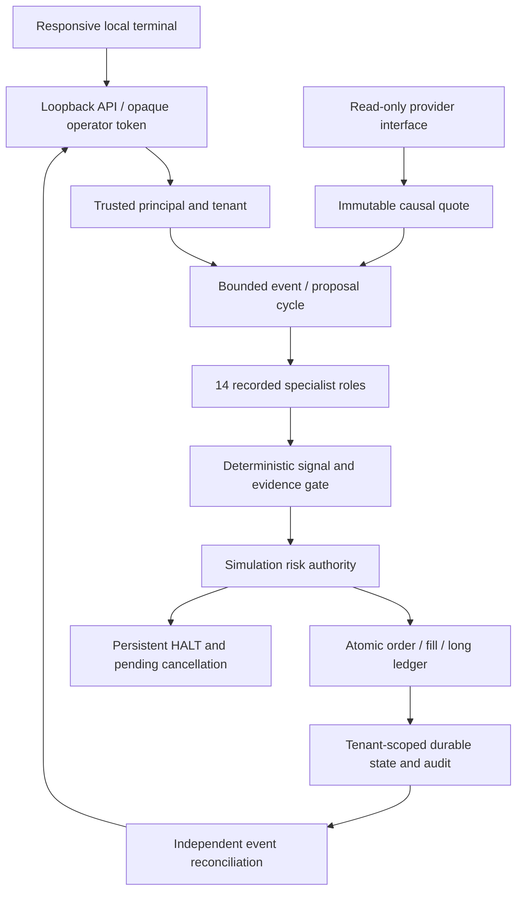

# v0.12 architecture and contracts

**Implemented scope: local, isolated synthetic simulation. Commercial/global platform: PARTIAL; beta decision: NO-GO.**

## Implemented data flow

The diagram represents application components in one trusted process. It does not imply independently deployed services. All order records identify `local-simulation` and `simulated: true`. No brokerage transport exists.

## Contracts and trust boundaries

| Contract | Implementation / machine schema | Invariant |
| --- | --- | --- |
| Principal | `paper/contracts.py`, `paper/identity.py` | Server token determines tenant and operator/viewer role; no tenant header or body authority |
| Quote | `paper/contracts.py`, `contracts/paper/quote.schema.json` | UTC microsecond ordering; positive finite Decimal prices/sizes; event, receipt and transport-age limits; quote identity/currency binding; immutable consumption |
| Proposal | `paper/contracts.py`, `contracts/paper/proposal.schema.json` | Exact supported fields; direction, size, stop, idempotency key, market/limit terms; no approval or policy field |
| Agent assessment | `paper/contracts.py`, `contracts/paper/agent-assessment.schema.json` | Role/model/prompt/version, UTC, bounded text, references and explicit status; never an execution token |
| Decision | `paper/contracts.py` | LONG/SHORT/FLAT/HALT/UNSUPPORTED/UNVERIFIED, reasons, input hashes, committee, planned loss, assumed fee and explicit false live authority |
| Order | `paper/engine.py` | Acknowledged → partial/filled/rejected/cancelled; durable request/fill identifiers; terminal states cannot fill |
| Audit | `paper/store.py` | Tenant sequence and hash chain; actor, event, timestamp, payload; local tampering detected, not independently notarised |

Runtime constructors and checks enforce cross-field/finite-value/freshness rules beyond JSON Schema. Decimal strings are preferred; integer inputs are supported; binary floating-point economics, booleans, nonfinite numbers and values outside the supported precision/range are rejected. UTC precision finer than microseconds is rejected rather than silently truncated.

All proposed stop-risk, fees and balances are in one explicit account currency. The foundation does not perform FX conversion. A finite quote/provenance reference does not establish source authentication, data rights, publication-time completeness, adjusted-equity correctness or market authenticity.

## Committee

The fourteen roles are orchestrator, market intelligence, technical, quantitative, fundamental, news, bull, bear, sceptic, portfolio, decision, execution, risk monitoring and performance. Their current outputs are deterministic records with model `deterministic-python/0.12` and prompt `none`. Fundamental/news providers are unavailable and explicitly UNVERIFIED. The optional async research-adapter interface validates bounded responses and timeouts; it is not connected to a model or included in risk approval. Prompt-injection tests show text remains data and privileged schema fields are rejected. This is not a claim of resistance for every future model/provider integration.

## Risk and order semantics

Preserved maximums: planned position loss 0.25%, aggregate planned stop-risk 1%, daily suspension 2%, peak drawdown suspension 5%, notional 1× equity. Daily/weekly loss comparisons use start-of-period equity; drawdown uses high-water equity; equality suspends entries. Previous marked equity anchors the first mark after a UTC period change, so a gap is not silently reset away. The baseline's stricter 20% position concentration and 30% total exposure defaults are retained for this adapter. Additional provisional controls: 4% weekly loss, 10% displayed-depth participation, 1% price deviation, ten accepted orders/minute. They are engineering policies, not optimised risk rules. Users can initialise stricter limits; no API can relax them.

Planned loss includes entry/exit assumed fees and a 1% stop-price gap allowance. Assumed defaults are 10 bps fee and 5 bps adverse slippage on each leg; spread comes from the synthetic bid/ask. These are uncalibrated assumptions. Larger gaps can exceed planned loss. Equity marks estimate liquidation at the adverse bid and assumed exit fee; those provisional costs are not charged to cash until an actual synthetic exit.

Authorisation and fill are separate transactions; fills recheck current policy, quote, account, pending exposure, partial inventory and connectivity. One outstanding order per account deliberately avoids unsupported reservation/correlation semantics. Entry idempotency binds the original proposal; repeated accepted requests return the existing order. Explicit partial-fill delivery IDs prevent duplicate updates. Full-fill retries are terminal-state idempotent.

Every risk-rejection HALT persists in this conservative adapter. HALT cancels pending synthetic orders and prevents entries across restarts. It does not claim to liquidate holdings or protect against gaps. Reducing an existing long requires a separate deterministic exit check and can proceed during HALT. Recovery never auto-enables a session. No short inventory or leverage accounting exists. The bounded async runner can consume a complete entry/stop sequence without per-event human decisions; it is not a 24/7 supervision service.

## Target service migration

| Phase | Target | Exit evidence |
| --- | --- | --- |
| Next | Separate risk authority, append-only evidence and provider-specific custody | Independent service identity, signed request/nonce tests, concurrent grants, deny-on-outage, externally pinned audit heads |
| Multi-user beta | Managed OIDC identity, MFA/passkeys/recovery, PostgreSQL RLS, managed secret references | Independent tenant/role/IDOR review, recovery abuse tests, backup restore and migration parity |
| Market expansion | Reviewed v0.11 equity work and licensed feeds | Calendars, holidays, corporate actions, delistings, FX, point-in-time replay and provider failover evidence |
| Broker sandboxes | Account-specific capabilities and order lifecycle adapter | Sandbox-only credentials, fee/fill/position reconciliation, outages and reconnect acceptance |
| Commercial beta | Quotas, entitlements, translations, onboarding and monitoring | Load/SLO evidence, unit economics, privacy/consumer/regulatory review |
| Conditional live readiness | Separate deployment/config/account/risk/regional gates | Independent strategy and security evidence, legal review, explicit live-pilot approval |

Use migration checksums, idempotent tenant IDs, event sequence parity, cash/position/fee parity and rollback snapshots when moving SQLite data. Never dual-write a real order during migration. Keep current research datasets and experiment identities immutable. The 2027-01-01 to 2028-01-01 UTC prospective interval remains reserved.
